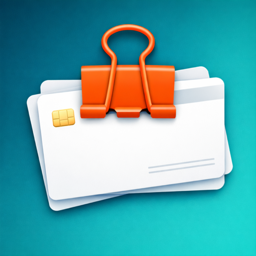
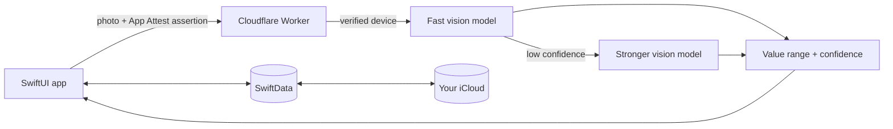

<a href="https://wilderlopezelias.com">
  <picture>
    <source media="(prefers-color-scheme: dark)" srcset="./assets/hero-dark.svg">
    
  </picture>
</a>

 

I build native software for Apple platforms end to end: architecture, SwiftUI, the backend glue, App Store review, analytics and the paywall. I started in Cuba on the country's national messaging app, worked on large-scale consumer apps for Grupo Salinas in Mexico, and today, from Novi Sad, I work on real-time video and VoIP apps for an Italian security company, lead iOS on a dating app for a US startup, and ship my own products on the App Store.

My north star: *if it doesn't feel native, it isn't done.*

## On the App Store

<table>
  <tr>
    <td width="112" align="center" valign="top">
      
    </td>
    <td valign="top">
      <b><a href="https://apps.apple.com/us/app/kist-antique-identifier/id6792853183">Kist</a></b> · Antique identifier 
      Snap a photo of an antique and get an honest value range with a confidence meter, never a fake-precise number. Your collection stays on your device and syncs through your own iCloud. No ads, no trial that quietly starts charging. 
      SwiftUI · SwiftData + CloudKit · App Attest · Cloudflare Workers · tiered vision models
    </td>
  </tr>
  <tr>
    <td width="112" align="center" valign="top">
      
    </td>
    <td valign="top">
      <b><a href="https://apps.apple.com/app/id6757620270">ClipCard Pro</a></b> · Crypto Vault 
      A vault for cards, crypto wallets and seed phrases that you paste from a keyboard that never gets Full Access. Copies expire on their own, everything syncs through your own iCloud, and exports are AES-256 encrypted with a password only you know. No account, no server, nothing leaves your devices.
      The rebuild of ClipCard, the first app I ever published, back in Cuba in 2021. 
      SwiftUI · StoreKit 2 · Core Data + CloudKit · CryptoKit · App Intents · Keyboard extension · Vision OCR · macOS native
    </td>
  </tr>
</table>

**Building next:** Ranket, a padel and tennis performance tracker with Apple Watch at its core.

## Inside Kist

A one-person app still deserves a real architecture. The API key never ships in the binary, only genuine copies of the app can reach the backend, and the expensive model runs only when the cheap one isn't sure. The result costs about one cent per identification.

## Production work

- **Anteklab, Italy** · Real-time video surveillance (AylookPro) and VoIP telephony (AbilisPhone) on iPhone. GStreamer · WebRTC · RxSwift · UIKit · GitLab CI
- **Conexxxion, US** · iOS Tech Lead on a dating app: real-time chat over WebSocket, resilient networking with retry and token refresh, product analytics. Swift · WebSocket · REST · Amplitude
- **Earlier** · ToDus, Cuba's national messaging app, where I built the XMPP framework at its core, and consumer apps at Grupo Salinas / UPAX in Mexico, including jailbreak detection for security compliance.

## Toolbox

<picture>
  <source media="(prefers-color-scheme: dark)" srcset="./assets/stack-dark.svg">
  
</picture>

## Elsewhere

[wilderlopezelias.com](https://wilderlopezelias.com) · [LinkedIn](https://www.linkedin.com/in/wilderlopezelias) · [Kist on X](https://x.com/kist_app)

<!--
Optional, only once you're fine with this being public:
Open to senior iOS roles, remote from Serbia, as a contractor or employee.
-->
